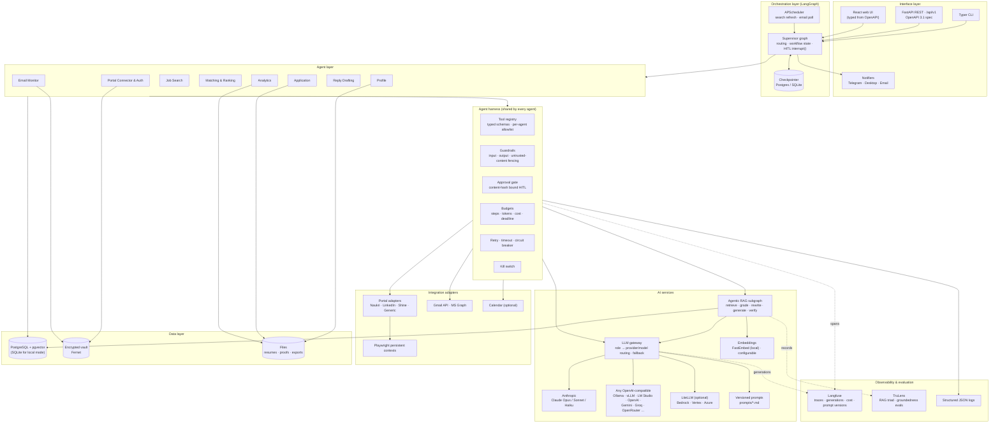
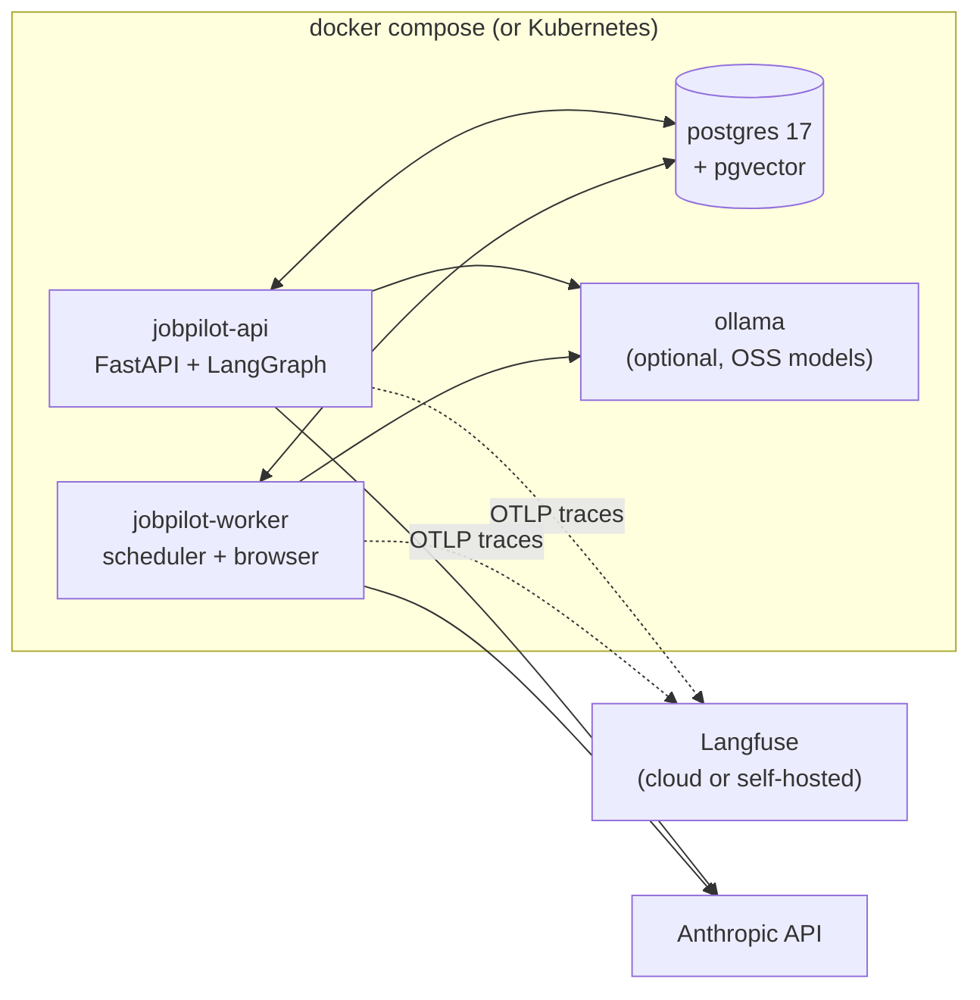
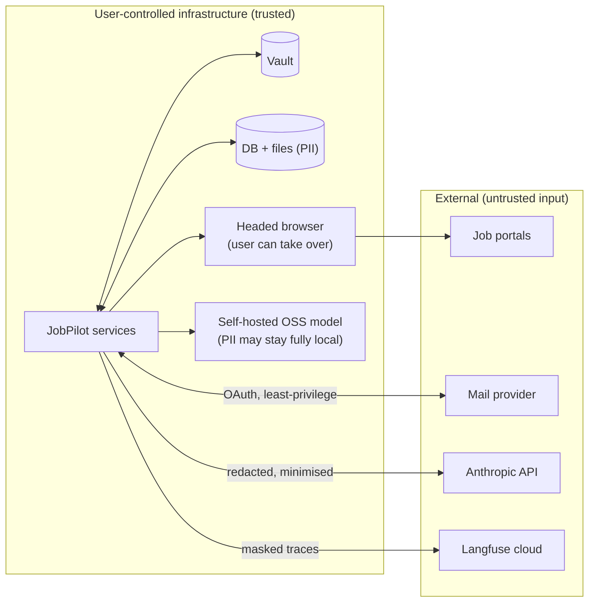

# 01 · Project Architecture

## Layered view

## Deployment view

## Trust boundaries

- Secrets never cross into an LLM or tracing boundary; the harness masks them before every call.
- Portal HTML and email bodies are fenced as untrusted data, never treated as instructions.
- Setting `llm.privacy_mode: local_only` routes every role to the self-hosted model, so no PII leaves the host.
