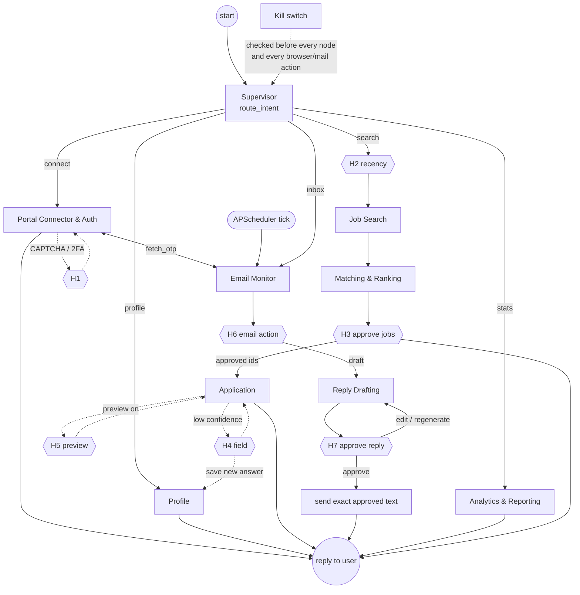
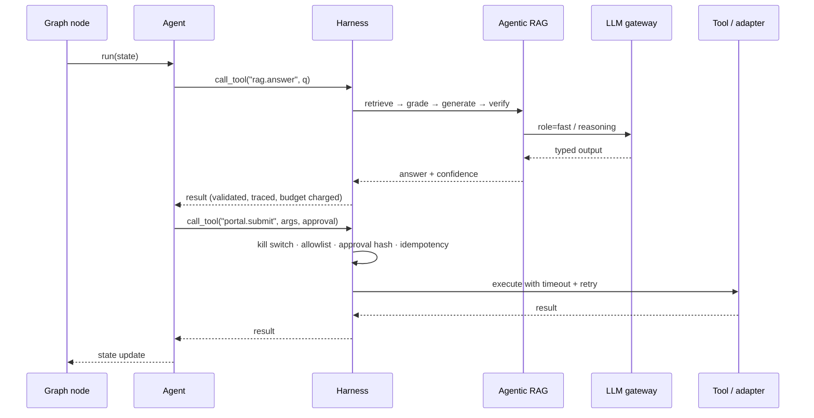
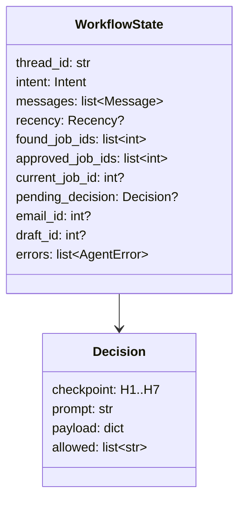
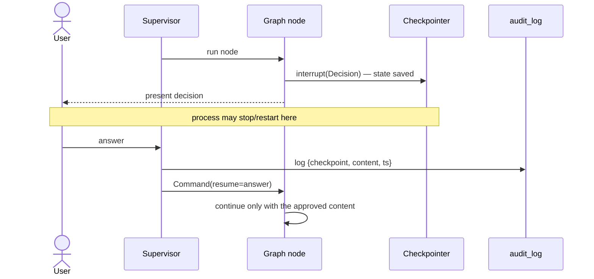

# 02 · All Agents — Supervisor Graph

## LangGraph topology

The supervisor is a `StateGraph`. Specialists are subgraph nodes. Each HITL checkpoint is an
`interrupt()` inside a node; the checkpointer persists state so a pending decision survives a restart.

## How every node runs

Each specialist node is a thin LangGraph node that delegates to its agent class. The agent runs inside the
[agent harness](04-agent-harness.md), which calls the [LLM gateway](05-llm-gateway.md) and the
[Agentic RAG subgraph](06-agentic-rag.md) on its behalf.

## Shared state (per workflow thread)

## HITL interrupt/resume sequence

