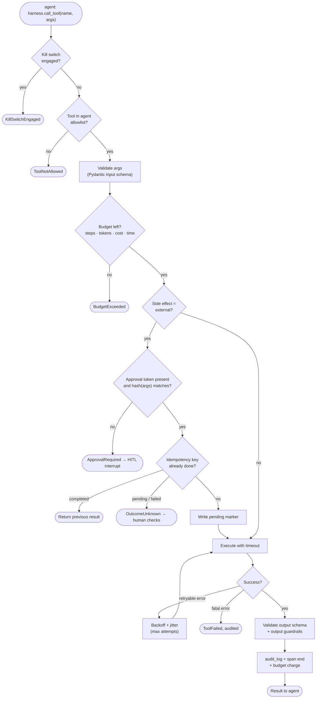
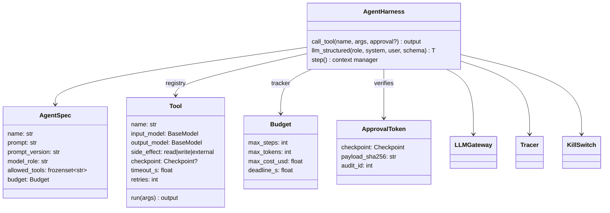

# 04 · Agent Harness

The harness is the runtime every agent executes inside. Agents hold only domain logic: a prompt,
a set of allowed tools and a budget. The harness owns everything that keeps them safe and observable.
No agent calls an LLM, a browser, or a mail API directly.

## Responsibilities

| Concern | Mechanism |
|---------|-----------|
| Tool contract | Each tool declares a Pydantic input/output schema, a timeout, a side-effect class (`read` / `write` / `external`) and an optional HITL checkpoint |
| Least privilege | Each agent has an allowlist; calling a tool outside it raises `ToolNotAllowed` |
| Approval binding | `external` tools (submit application, send email) need an approval token whose SHA-256 matches the exact payload being executed |
| Budgets | Per-run limits on steps, tokens, cost (USD) and wall-clock deadline; a breach stops the run with a typed error |
| Reliability | Exponential backoff with jitter for retryable errors only; per-tool timeout; circuit breaker per portal/provider |
| Guardrails | Input: untrusted content fenced in tags, secrets redacted before any LLM call. Output: schema validation, then domain checks (e.g. "never invent salary or experience") |
| Kill switch | Checked before every step and every side-effecting tool call |
| Idempotency | External tools take an idempotency key (`apply:<job_id>`, `send:<draft_id>:<sha>`). A *pending* marker is written before execution and the result after it; a repeat of a completed key returns the stored result, and a repeat of a pending or failed key stops with `OutcomeUnknown` so a human checks first |
| No blind retries | External tools cannot auto-retry (a timed-out call may still be running). The caller retries deliberately, after checking the outcome, with a new key |
| Observability | One Langfuse span per agent run, nested spans per tool, generations per LLM call; every decision to `audit_log` |
| Prompt versioning | Prompts are files with a version header; the version is attached to every trace for regression analysis |

## Execution pipeline for one tool call

## Component view

## Default per-agent harness profile

| Agent | Model role | Max steps | Max cost (USD) | External tools |
|-------|-----------|-----------|----------------|----------------|
| Supervisor | `router` | 20 | 0.20 | none |
| Portal Connector | `reasoning` | 30 | 0.50 | none (login is user-visible) |
| Profile | `extraction` | 10 | 0.30 | none |
| Job Search | `fast` | 50 | 0.50 | none |
| Matching | `fast` | 200 | 1.00 | none |
| Application | `reasoning` | 40 / job | 0.50 / job | `submit_application` (H3 + H5) |
| Email Monitor | `fast` | 100 | 0.30 | none |
| Reply Drafting | `writing` | 10 | 0.30 | `send_email` (H7) |
| Analytics | `fast` | 5 | 0.05 | none |
