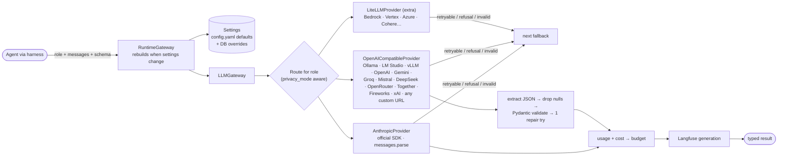

# 05 · LLM Gateway (open-source and paid models)

Agents ask for a **role** (`reasoning`, `extraction`, `writing`, `fast`, `router`, `judge`), never a
vendor model. Each role maps to a provider and model, with an ordered fallback chain. JobPilot ships
with **every role on local open-source models (Ollama)**; any role can be switched to any provider and
model from the **Models** page in the UI, the REST API, or `config.yaml`.

## Where settings live

| Layer | What | Notes |
|-------|------|-------|
| `config.yaml` | Default providers and role routes | Ships with Ollama for every role |
| Database (`llm_providers`, `model_routes`, `app_settings`) | Providers you add, per-role overrides, privacy mode | Edited from the UI/API; every change bumps a revision and running gateways rebuild on the next call, no restart |
| Vault | Provider API keys | Fernet-encrypted; never returned by the API, never logged or traced |
| Environment | `ANTHROPIC_API_KEY`, `OPENAI_API_KEY`, … | Used when no key is stored for a provider |

## Provider settings that matter for open-source models

These defaults come from measurements on a laptop with `qwen3:8b`, `gemma3:12b`, `gemma3:4b` and
`llama3.2:3b` through Ollama 0.34, extracting a profile from a short resume:

| Setting | Default for local presets | Why |
|---------|---------------------------|-----|
| `structured_mode: json_object` | yes | With grammar-constrained `json_schema`, models returned a valid but **empty** profile (every field has a default, so stopping early is legal). `json_object` plus an example in the prompt returned complete profiles. |
| Example skeleton, not raw JSON Schema | always | Given a raw schema, `llama3.2:3b` answered with the schema itself. A filled-in example with `a \| b` enum options is followed reliably; optional numbers show `null`, because a `0` placeholder was copied as a fact ("Java: 0 years"). |
| `reasoning_effort: none` | Ollama | Qwen3's hidden thinking took ~220 s (first attempt hit the timeout); with thinking off: **~12–19 s, same result**. Non-thinking models accept and ignore it. |
| `timeout_s: 300` | local providers | Local inference on laptop hardware can exceed the 120 s cloud default. |

Null values in model output are dropped before validation so field defaults apply, and required
fields still fail validation.

## Privacy mode

`local_only` sends prompts only to providers whose base URL is localhost, a loopback or
private-network IP literal. Cloud targets in a route or its fallbacks are skipped, and a role with no
local target fails rather than silently using the cloud. The same mode keeps prompt content out of
traces unless Langfuse is local ([07](07-observability-and-evals.md)).

Claude is always called through the official `anthropic` SDK; the OpenAI-compatible client is used only
for servers that expose that wire format.
