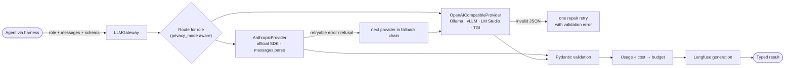

# 05 · LLM Gateway (open-source and paid models)

Agents ask for a **role** (`router`, `reasoning`, `extraction`, `writing`, `fast`, `judge`), never a
vendor model. `config.yaml` maps each role to a provider and model, with an ordered fallback chain.
Switching the whole system from Claude to a local Llama/Qwen model is a config change.



## Example configuration

```yaml
llm:
  privacy_mode: standard          # local_only forces every role to the local provider
  providers:
    anthropic: {type: anthropic}
    local:     {type: openai_compatible, base_url: http://localhost:11434/v1, api_key_env: OLLAMA_API_KEY}
  roles:
    reasoning:  {provider: anthropic, model: claude-opus-5-5, fallbacks: [{provider: local, model: qwen3:14b}]}
    extraction: {provider: anthropic, model: claude-sonnet-5-5}
    writing:    {provider: anthropic, model: claude-opus-5-5}
    fast:       {provider: anthropic, model: claude-haiku-5-5, fallbacks: [{provider: local, model: llama3.2:3b}]}
    router:     {provider: anthropic, model: claude-haiku-5-5}
    judge:      {provider: anthropic, model: claude-sonnet-5-5}
```

Claude is always called through the official `anthropic` SDK. The OpenAI-compatible provider exists
only for self-hosted open-source servers that expose that wire format.
