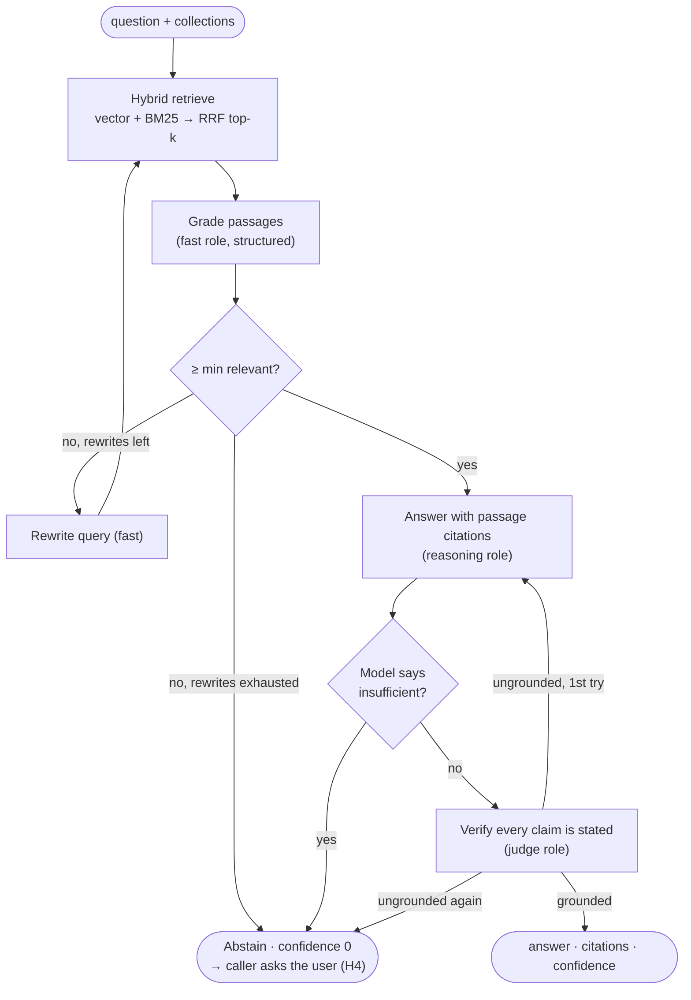

# 06 · Agentic RAG

Retrieval is an agent, not a single lookup. It decides whether to retrieve, grades what came back,
rewrites the query when the evidence is weak, and refuses to answer when it cannot ground the answer.
That last property matters here: the Application agent must never invent experience, salary or qualifications.

## Knowledge collections

| Collection | Content | Kept in sync by |
|-----------|---------|-----------------|
| `profile` | Profile facts rendered as one sentence per topic ("Notice period: 60 days.") | `KnowledgeBase.sync()` |
| `answers` | User-confirmed Answer Bank entries (unconfirmed drafts are never indexed) | same |
| `resume` | Resume text, chunked by paragraph/sentence with overlap | same |

Jobs and email threads join as collections in later phases. Documents are re-embedded only when
their content or the embedding model changes.

**Storage and search.** Chunks live in the `rag_chunks` table (SQLite or Postgres) with float32
embeddings; search is exact cosine in numpy, which is fast at one candidate's scale (thousands of
chunks). Retrieval is hybrid: dense vectors (FastEmbed `BAAI/bge-small-en-v1.5`, local ONNX) plus
BM25 keywords, fused with reciprocal rank fusion. A hashing embedder exists for tests and is labelled
so its chunks are never mixed with semantic ones. A pgvector index is the planned optimisation if a
collection grows past what exact search handles.

## Subgraph

**Confidence is deterministic**, never self-rated by the model: 0.9 when verified and citing a
relevant passage, 0.5 when verified but citing nothing, 0 on abstention. The Application agent
compares it with `answer_confidence_threshold` (0.8): below it, the user decides (H4).

## Measured on local models

Run on a laptop with qwen3:8b (answer), llama3.2:3b (grade, rewrite) and gemma3:12b (verify):

| Question type | Result | Latency |
|---------------|--------|---------|
| Notice period, Kafka years, expected CTC | Correct, cited, 0.9 | 25–52 s |
| "Why are you leaving?" | Reuses the saved Answer Bank answer (after prompt v3) | ~26 s |
| PMP certification, visa sponsorship (not in profile) | Abstains (after prompt v2) | ~50 s |

Two failure modes found and fixed in the prompts: answering **"No"** for a fact that is simply not
mentioned (absence is not evidence), and replacing the user's saved answer with a generic one.
`jobpilot eval rag` keeps both as regression cases.
