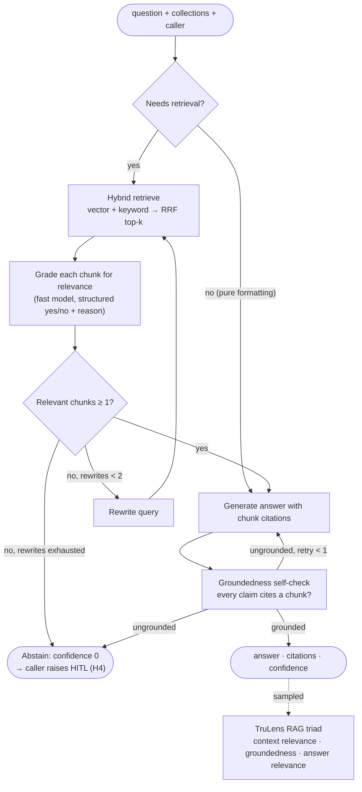

# 06 · Agentic RAG

Retrieval is an agent, not a single lookup. It decides whether to retrieve, grades what came back,
rewrites the query when the evidence is weak, and refuses to answer when it cannot ground the answer.
That last property matters here: the Application agent must never invent experience, salary or qualifications.

## Knowledge collections

| Collection | Content | Used by |
|-----------|---------|---------|
| `profile` | Profile facts rendered as sentences, one chunk per field group | Application, Reply, Matching |
| `resume` | Resume text, chunked per section | Application, Matching |
| `answers` | Confirmed Answer Bank entries | Application (H4 suggestions) |
| `jobs` | Job descriptions | Matching, Reply ("what was this role?") |
| `emails` | Email threads | Reply Drafting, Email Monitor linking |

Storage is `pgvector` in Postgres (an in-process store in SQLite local mode). Retrieval is hybrid:
dense vectors plus keyword scoring, fused with reciprocal rank fusion.

## Subgraph

The returned `confidence` feeds the Application agent's threshold check: below
`answer_confidence_threshold` the harness raises H4 and the user decides.
