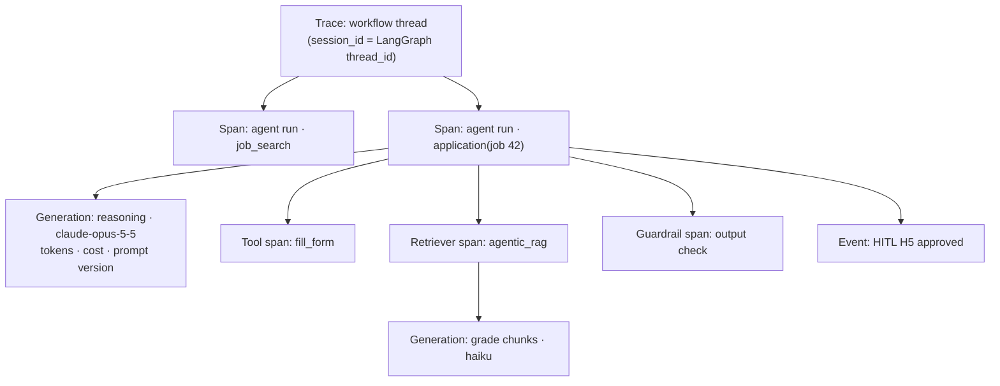

# 07 · Observability and Evaluation

## Tracing with Langfuse

- Every LLM call is a Langfuse `generation` with model, token usage, cost and prompt version.
- Every tool call is a `tool` observation; RAG is a `retriever`; guardrails are `guardrail` observations.
- A `mask` function strips secrets and contact details before export.
- Tracing turns off cleanly when `LANGFUSE_*` keys are absent (no-op tracer).
- With `privacy_mode: local_only`, prompt and output content is exported only to a local or private-network
  Langfuse. For any other host, traces keep timing, token usage and errors but replace content with a placeholder.

## Evaluation with TruLens

| Suite | Metric | Gate |
|-------|--------|------|
| RAG (Application answers) | Groundedness, context relevance, answer relevance | groundedness ≥ 0.9 |
| Reply drafting | Answer relevance to user instruction, groundedness against thread + profile | ≥ 0.8 |
| Matching | Agreement with labelled golden set (deterministic, pytest) | ≥ 0.85 |
| Email classification | Accuracy on labelled golden set | ≥ 0.9 |

TruLens runs offline (`jobpilot eval rag`) against golden datasets in `evals/datasets/`, and online on a
sampled fraction of production RAG calls. The judge model is the `judge` role, so it can be Claude or a
local model. Scores are also pushed to Langfuse as trace scores, so regressions show up next to the trace.
