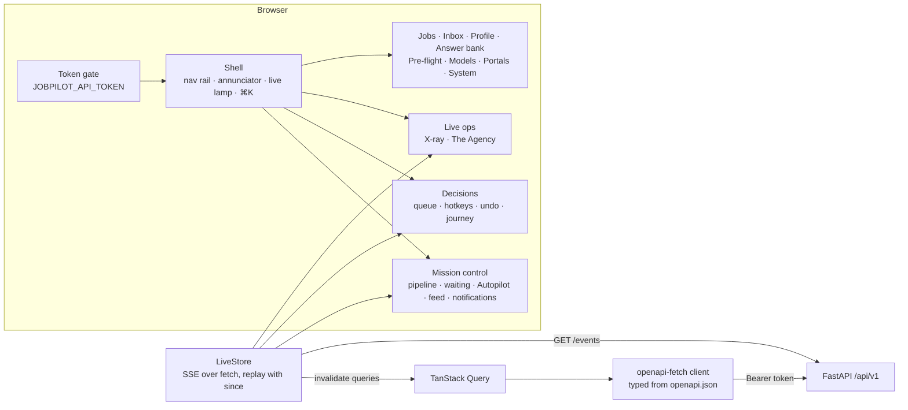

# 10 · Web UI

React 19 + TypeScript, built with Vite and served by FastAPI at `/` on the same origin as the API.
Types for every request and response are generated from the OpenAPI spec (`npm run gen:api`), so a
backend contract change fails the frontend typecheck.

| Page | What you can do |
|------|-----------------|
| Mission control (`/`) | Today's pipeline (search → rank → approve → apply → replies) with live progress, what is waiting for you, Autopilot schedule and "run now", the live activity feed, desktop and Telegram notifications |
| Decisions (`/approvals`) | One decision at a time with "if you approve" spelled out and the job's journey. Keys: J/K move, A approve, R reject, E edit, U undo. Approving H3, submitting at H5 and sending at H7 wait 5 seconds so you can undo. Focus mode hides everything else. Applications list with confirmation and proof |
| Live ops (`/live`) | Watch the agents. **X-ray**: every agent, the harness rim with its gates, external systems and your approval gate (Shell / X-ray / Exploded depth). **The Agency**: the same work as people in an office, walking files between desks and to your in-tray. **Live** follows real events; **Demo** plays a full day, with approve / reject at each gate |
| Pre-flight (`/setup`) | Readiness checklist, which model flies each role, stop everything |
| Profile | Drop a resume (live progress while the model reads it), answer the questions it cannot (salary, notice, preferences: never inferred), edit any field, see every version |
| Answer bank | Save reusable screening answers |
| Jobs | Pick the recency window (H2) and sources, add careers-page URLs, import one page, review ranked jobs with match dial, reason, red flags and every source listing |
| Inbox | Connect Gmail / Outlook / a local test mailbox (with optional calendar checks); check now; job emails filtered by category or "needs you", with linked application, status, suggested status and "Reply again" |
| Portals | Enable a portal after accepting its terms note, sign in (browser opens) or store a password, see session status and H1 alerts |
| Models | Switch privacy mode; pick any provider and model per role from the provider's live model list (or type any id); add fallbacks; run a "test flight"; add providers from presets or any OpenAI-compatible URL; store API keys encrypted |
| System | Kill switch, health, sign out |

**Command bar.** ⌘K (Ctrl+K) anywhere, or the search pill in the top bar: jump to any page or
waiting decision, check mail, run Autopilot, switch theme, stop or resume the agents. "Stop
everything" asks for a second Enter.

**Live updates.** One SSE stream (`/api/v1/events`) drives the pipeline, the feed, the decision
badge (also in the tab title), desktop notifications and Live ops. It reconnects with backoff and
replays what it missed with `since`.

Reports appear in the navigation as a locked item until Phase 5 ships.

**Design.** Two themes from one set of tokens: "Paper & Ink" by day (warm paper, Fraunces
display) and "Night Shift" by night (near-black, Space Grotesk display, amber instruments); Inter
Tight for UI and JetBrains Mono for data. It follows the OS and is switchable. Colour is semantic:
amber = needs you, green = done/approved, blue = working, red = stop. Motion uses
transform/opacity only and respects `prefers-reduced-motion`.

**Run it.** Production: `cd web && npm ci && npm run build`, then `uv run jobpilot api serve` and open
http://127.0.0.1:8765. Development: `npm run dev` (port 5173, proxies `/api` to 8765). Requires Node 22+ (`.nvmrc`: 24).
