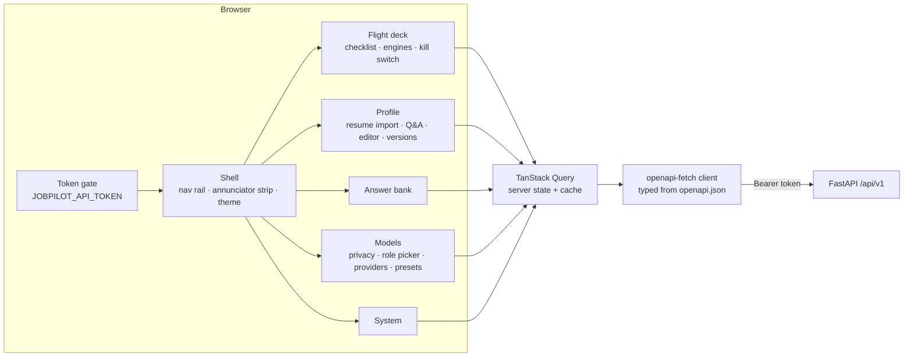

# 10 · Web UI

React 19 + TypeScript, built with Vite and served by FastAPI at `/` on the same origin as the API.
Types for every request and response are generated from the OpenAPI spec (`npm run gen:api`), so a
backend contract change fails the frontend typecheck.

| Page | What you can do |
|------|-----------------|
| Flight deck | See readiness, which model flies each role, stop everything |
| Profile | Drop a resume (the extraction model reads it), answer the questions it cannot (salary, notice, preferences: never inferred), edit any field, see every version |
| Answer bank | Save reusable screening answers |
| Jobs | Pick the recency window (H2) and sources, add careers-page URLs, import one page, review ranked jobs with match dial, reason, red flags and every source listing |
| Portals | Enable a portal after accepting its terms note, sign in (browser opens) or store a password, see session status and H1 alerts |
| Models | Switch privacy mode; pick any provider and model per role from the provider's live model list (or type any id); add fallbacks; run a "test flight"; add providers from presets or any OpenAI-compatible URL; store API keys encrypted |
| System | Kill switch, health, sign out |

Approvals, inbox and reports appear in the navigation as locked items until their phase ships.

**Design.** "Flight deck" direction: warm paper and ink by day, cockpit black with amber
instruments by night (follows the OS, switchable). Instrument Serif for display, Geist and Geist Mono
for UI and data. Colour is semantic: amber = attention, green = local/approved, blue = cloud,
red = kill switch. Motion uses transform/opacity only and respects `prefers-reduced-motion`.

**Run it.** Production: `cd web && npm ci && npm run build`, then `uv run jobpilot api serve` and open
http://127.0.0.1:8765. Development: `npm run dev` (port 5173, proxies `/api` to 8765). Requires Node 22+ (`.nvmrc`: 24).
