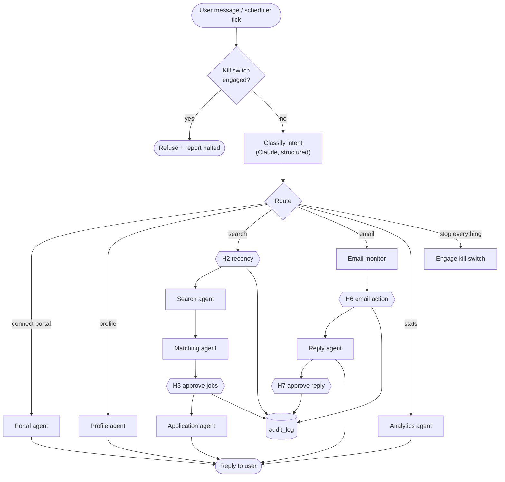

# Agent 1 · Orchestrator / Supervisor

**Responsibility:** single entry point. Interprets the request, routes to a specialist, keeps workflow state, owns every HITL checkpoint (H1–H7) and the kill switch.

| Input | Output |
|-------|--------|
| `UserMessage {text, session_id}` or scheduler event | `AgentReply {text, table?, pending_decision?}` |

**Tools:** `route_intent` (Claude structured output), `interrupt()` / `Command(resume=…)`, `audit.log_decision`, `killswitch.check`.

Every `{{Hn}}` node is a LangGraph `interrupt()`: state is checkpointed, the process may restart, and the graph resumes only on an explicit answer.

## Harness & AI

| Aspect | Value |
|--------|-------|
| Model role (gateway) | router |
| RAG collections | none |
| Allowed tools | route_intent, present_decision, engage_kill_switch |
| Tracing | one Langfuse span per run; tools, retrievals and generations nested |

Runs inside the [agent harness](../04-agent-harness.md): kill switch, allowlist, budgets, retries and approval binding apply to every tool call.

## Implementation (Phase 3)

- `agents/orchestrator/apply_graph.py`: review (H3) → next → attempt → ask_field (H4) /
  ask_preview (H5) / retry / record → next. Pausing nodes only call `interrupt()` and log.
- `agents/orchestrator/runtime.py`: runs graphs on one background worker (applications strictly
  one at a time), indexes runs in `workflow_runs`, lists pending decisions, resumes them with
  `Command(resume=...)`, and on startup continues runs interrupted by a crash. The LangGraph
  SQLite checkpointer (`data/workflows.db`) holds the state, so pending decisions survive restarts.
- Answering is race-free: `resume` claims the run with one conditional update
  (`waiting` → `running`), so of two concurrent answers (double click, two tabs) only one wins.
  The answer is bound to its interrupt (`Command(resume={interrupt_id: answer})`), and the worker
  checks again that the decision is still pending before resuming.
- An invalid H3 selection is asked again with the reason rather than failing the run; the API
  also validates answers before resuming, and refuses to answer a decision that is no longer pending.
