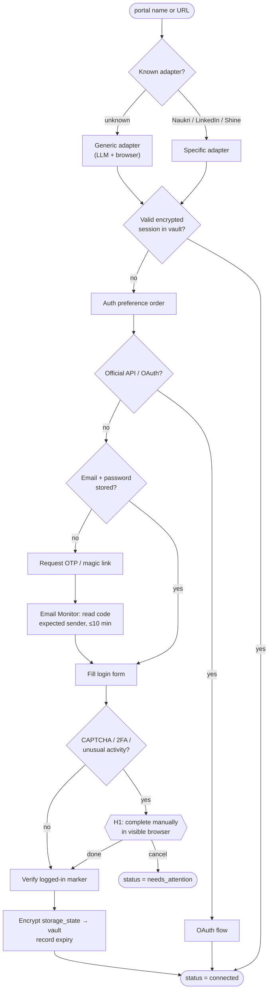

# Agent 2 · Portal Connector & Auth

**Responsibility:** connect to a portal by name or URL, authenticate as the user, persist encrypted sessions.

| Input | Output |
|-------|--------|
| `ConnectRequest {portal_or_url, auth_hint?}` | `PortalAccount {portal, auth_type, status, last_login, session_expires_at}` |

**Tools:** adapter registry, Playwright persistent context, vault (encrypt/decrypt), Email Monitor `fetch_otp(sender, max_age=10m)`.

Never solves CAPTCHAs, never rotates proxies. Any block/warning page sets the portal to `blocked` and stops only that portal.

## Harness & AI

| Aspect | Value |
|--------|-------|
| Model role (gateway) | reasoning (generic adapter only) |
| RAG collections | none |
| Allowed tools | adapter.login, adapter.check_session, email.fetch_otp, vault.store_session |
| Tracing | one Langfuse span per run; tools, retrievals and generations nested |

Runs inside the [agent harness](../04-agent-harness.md): kill switch, allowlist, budgets, retries and approval binding apply to every tool call.
