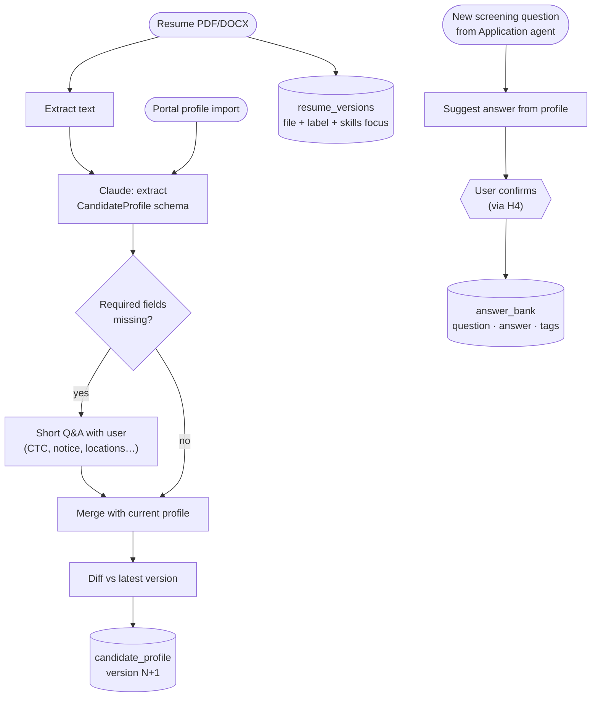

# Agent 3 · Profile

**Responsibility:** build and version the candidate profile, manage resume versions and the Screening Answer Bank.

| Input | Output |
|-------|--------|
| resume file, portal profile import, Q&A answers, `ProfilePatch` | `CandidateProfile` (new version), `AnswerBankEntry[]` |

**Tools:** PDF/DOCX text extraction, Claude structured extraction, profile repository (versioned), answer bank repository.

Profile writes are append-only: a change creates a new version row; `current` points to the latest.

## Harness & AI

| Aspect | Value |
|--------|-------|
| Model role (gateway) | extraction |
| RAG collections | writes `profile`, `resume`, `answers` |
| Allowed tools | parse_resume, extract_profile, save_profile_version, upsert_answer |
| Tracing | one Langfuse span per run; tools, retrievals and generations nested |

Runs inside the [agent harness](../04-agent-harness.md): kill switch, allowlist, budgets, retries and approval binding apply to every tool call.
