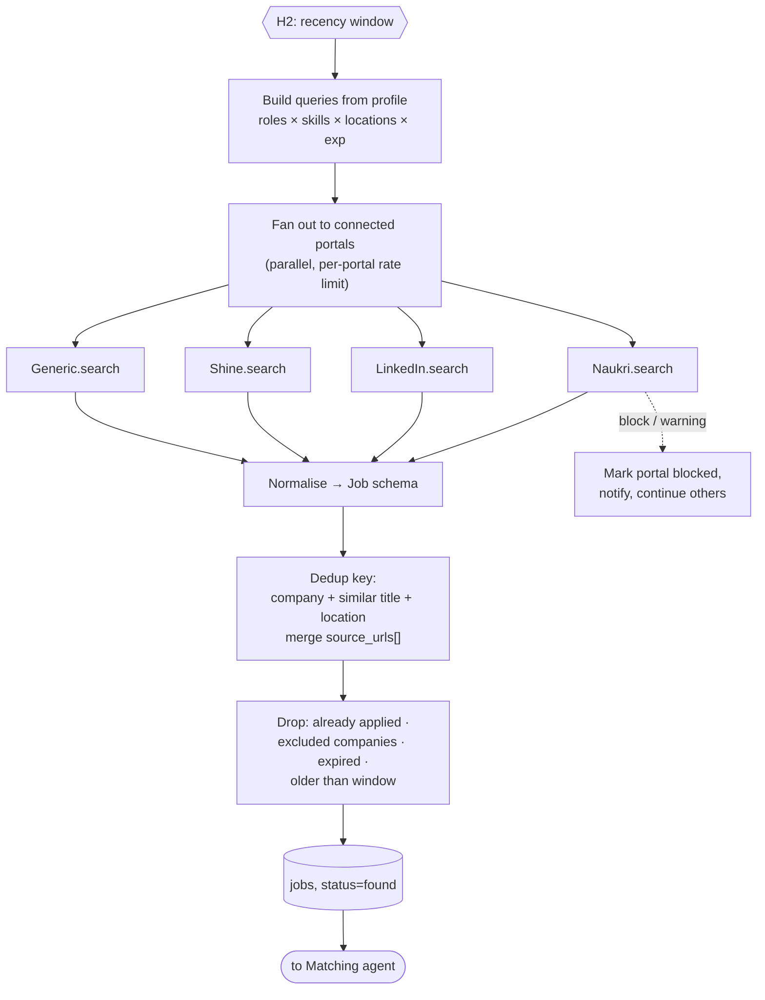

# Agent 4 · Job Search

**Responsibility:** turn the profile into queries, search every connected portal within the chosen recency window, normalise and deduplicate.

| Input | Output |
|-------|--------|
| `SearchRequest {recency: 1h·24h·7d·30d·custom, portals?}` | `Job[]` (normalised, deduplicated, filtered) |

**Tools:** query builder, portal adapters `search(query, since)`, dedup engine, jobs repository.

## Harness & AI

| Aspect | Value |
|--------|-------|
| Model role (gateway) | fast (query building) |
| RAG collections | none |
| Allowed tools | adapter.search, normalise_job, dedup_jobs, save_jobs |
| Tracing | one Langfuse span per run; tools, retrievals and generations nested |

Runs inside the [agent harness](../04-agent-harness.md): kill switch, allowlist, budgets, retries and approval binding apply to every tool call.
