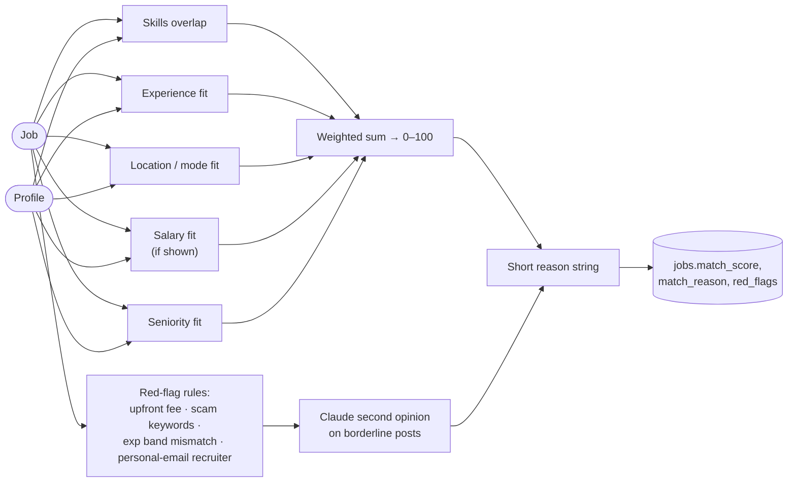

# Agent 5 · Matching & Ranking

**Responsibility:** score each job 0–100 against the profile with a short reason and flag red flags.

| Input | Output |
|-------|--------|
| `Job[]`, `CandidateProfile` | `ScoredJob {job_id, score, reason, sub_scores, red_flags[]}` |

**Tools:** deterministic scorer (skills, experience, location, salary, seniority), Claude for reason text and scam heuristics.

The numeric score is deterministic (unit-testable); the LLM only writes the reason and reviews borderline red flags.

## Harness & AI

| Aspect | Value |
|--------|-------|
| Model role (gateway) | fast (reason text), judge (red-flag second opinion) |
| RAG collections | reads `profile`, `resume`, `jobs` |
| Allowed tools | score_job, flag_red_flags |
| Tracing | one Langfuse span per run; tools, retrievals and generations nested |

Runs inside the [agent harness](../04-agent-harness.md): kill switch, allowlist, budgets, retries and approval binding apply to every tool call.
