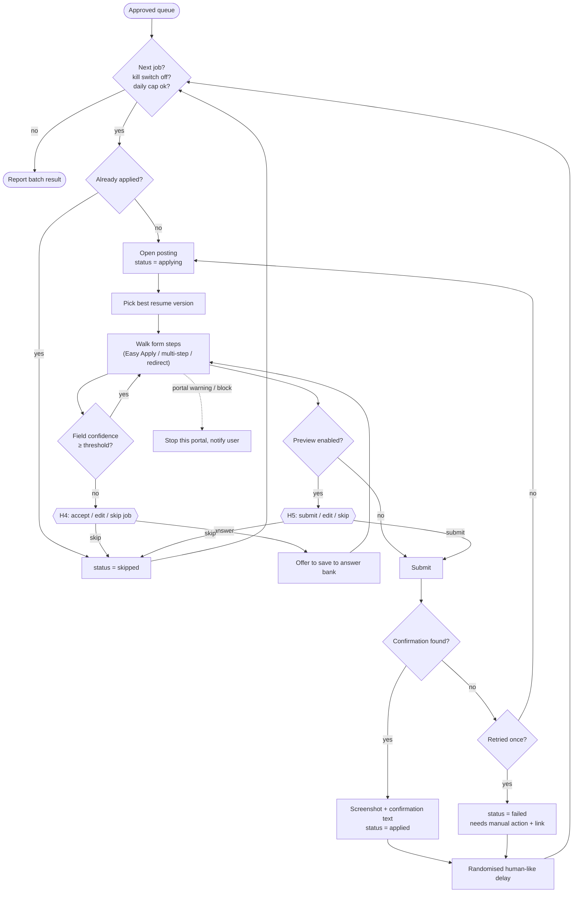

# Agent 6 · Application

**Responsibility:** apply to approved jobs strictly one at a time, never inventing answers, with proof capture.

| Input | Output |
|-------|--------|
| `approved job_ids[]` | `Application {job_id, resume_used, answers_given, status, proof_path, error}` |

**Tools:** portal adapter `apply(job, filler)`, resume selector, form filler (profile + answer bank + confidence), screenshot capture, rate limiter, kill switch.

## Harness & AI

| Aspect | Value |
|--------|-------|
| Model role (gateway) | reasoning |
| RAG collections | reads `profile`, `resume`, `answers` for every form field |
| Allowed tools | adapter.open_posting, select_resume, rag.answer_field, adapter.fill, adapter.submit (external, H5), capture_proof |
| Tracing | one Langfuse span per run; tools, retrievals and generations nested |

Runs inside the [agent harness](../04-agent-harness.md): kill switch, allowlist, budgets, retries and approval binding apply to every tool call.
