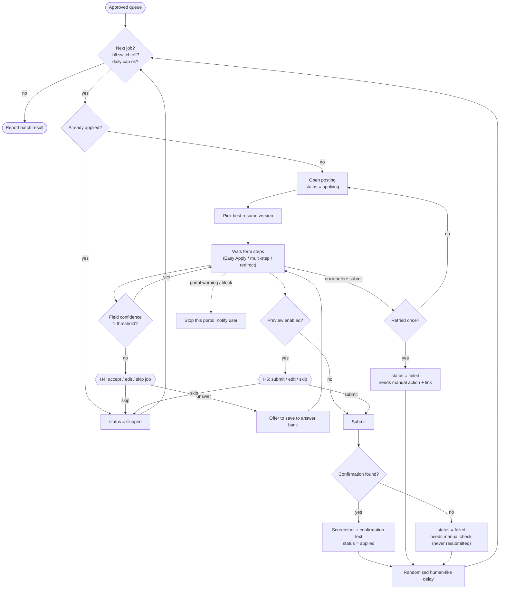

# Agent 6 · Application

**Responsibility:** apply to approved jobs strictly one at a time, never inventing answers, with proof capture.

| Input | Output |
|-------|--------|
| `approved job_ids[]` | `Application {job_id, resume_used, answers_given, status, proof_path, error}` |

**Tools:** portal adapter `apply(job, filler)`, resume selector, form filler (profile + answer bank + confidence), screenshot capture, rate limiter, kill switch.

## Harness & AI

| Aspect | Value |
|--------|-------|
| Model role (gateway) | reasoning |
| RAG collections | reads `profile`, `resume`, `answers` for every form field |
| Allowed tools | adapter.open_posting, select_resume, rag.answer_field, adapter.fill, adapter.submit (external, H5), capture_proof |
| Tracing | one Langfuse span per run; tools, retrievals and generations nested |

Runs inside the [agent harness](../04-agent-harness.md): kill switch, allowlist, budgets, retries and approval binding apply to every tool call.

## Implementation (Phase 3)

**Replay, don't resume the browser.** An attempt always starts from the posting: open → Apply →
fill every step → submit. It returns as soon as it needs you (a required field below the
confidence threshold → H4, or the pre-submit preview → H5). The workflow stores your answer in
its checkpointed state and starts a fresh attempt. Graph nodes that pause never touch the
browser, so a restart can't repeat a click halfway through a form.

**Where answers come from** (`agents/application/answers.py`), in order: your H4/H5 answer for
that field, a value the portal prefilled from your account, profile rules (name, contact, links,
experience, CTC in the form's units, notice period in the form's units), the confirmed Answer
Bank, then Agentic RAG for required fields only. Choices are mapped onto the form's real options
(yes/no, numeric bands like "6-9 years"). An optional field nothing covers stays blank; a required
one goes to you. Nothing is invented.

**Submitting** is the external tool `apply.submit`. With preview on (default) it needs an H5
approval whose hash matches `{job_id, answers}`, exactly what the preview showed. With preview off
it needs the job's H3 approval, bound to `{job_id}`. The idempotency key is the approval
(`apply:{job_id}:{checkpoint}:{audit_id}`), not the attempt, so one approval clicks Submit at most
once however often the attempt is replayed or retried. The submit button is re-detected on the live page, so the approved
payload never contains selectors.

**Proof**: a full-page screenshot (`apply.proof`) and the confirmation text.

**Unconfirmed submits**: if Submit ran (or may have run: an error mid-click, or an earlier
pending/failed marker) but no confirmation came back, the outcome is `submitted_unconfirmed`. It
is never retried, the job goes to `failed` with "needs manual check", and it counts toward the
daily cap, because a second click could apply twice.

**Limits**: failures before Submit retry once, then "Failed – needs manual action" with reason and link; daily cap per
portal (default 25, rolling 24 h); randomised gaps between applications; a blocked portal stops
for the rest of the run while others continue.

**Verified** in real Chrome against a local multi-step application site (JavaScript "Next",
POSTed final step): the server received exactly the expected values, and nothing before the H5
approval. Portal-specific Apply flows on Naukri, LinkedIn and Shine use the same generic form
engine and are not verified against the live sites.
