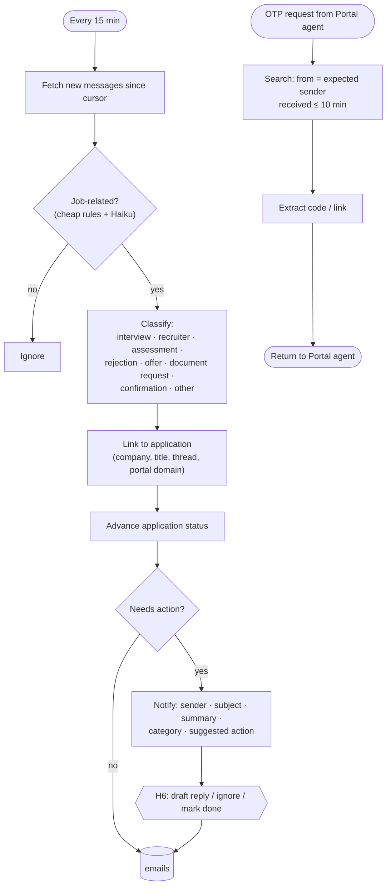

# Agent 7 · Email Monitor

**Responsibility:** poll the mailbox, classify job emails, link them to applications, notify the user; also serves OTP lookups for the Portal agent.

| Input | Output |
|-------|--------|
| scheduler tick (default 15 min), `OtpRequest {sender, max_age}` | `Email {category, linked_application_id, action_status}`, notification, OTP code |

**Tools:** Gmail API / MS Graph (read · draft · send scopes), Claude Haiku classifier, application linker, notifier registry.

## Harness & AI

| Aspect | Value |
|--------|-------|
| Model role (gateway) | fast |
| RAG collections | writes `emails`; reads `jobs` for linking |
| Allowed tools | mail.list_new, classify_email, link_application, notify, mail.fetch_otp |
| Tracing | one Langfuse span per run; tools, retrievals and generations nested |

Runs inside the [agent harness](../04-agent-harness.md): kill switch, allowlist, budgets, retries and approval binding apply to every tool call.
