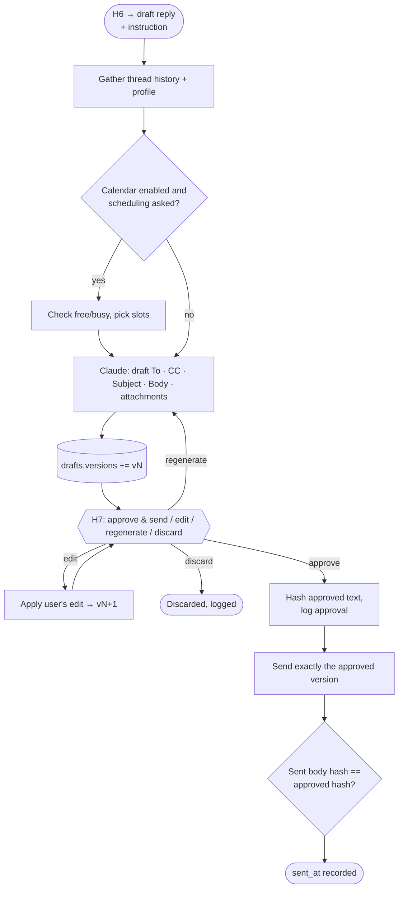

# Agent 8 · Reply Drafting

**Responsibility:** write a reply only after H6 = "draft reply"; send only the exact text approved at H7.

| Input | Output |
|-------|--------|
| `DraftRequest {email_id, user_instruction}` | `Draft {versions[], approved_version, sent_at}` |

**Tools:** thread fetch, profile, calendar free/busy (optional), Claude drafting, mail `create_draft` / `send`.

An edit always produces a new version that must be approved again; there is no path from `edit` to `send`.

## Harness & AI

| Aspect | Value |
|--------|-------|
| Model role (gateway) | writing |
| RAG collections | reads `emails`, `profile`, `jobs` |
| Allowed tools | mail.get_thread, calendar.free_busy, draft_reply, mail.send (external, H7) |
| Tracing | one Langfuse span per run; tools, retrievals and generations nested |

Runs inside the [agent harness](../04-agent-harness.md): kill switch, allowlist, budgets, retries and approval binding apply to every tool call.
