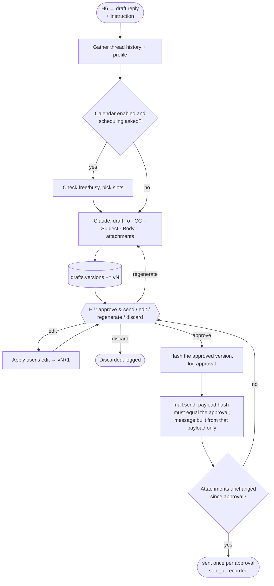

# Agent 8 · Reply Drafting

**Responsibility:** write a reply only after H6 = "draft reply"; send only the exact text approved at H7.

| Input | Output |
|-------|--------|
| `DraftRequest {email_id, user_instruction}` | `Draft {versions[], approved_version, sent_at}` |

**Tools:** thread fetch, profile, calendar free/busy (optional), Claude drafting, mail `create_draft` / `send`.

An edit always produces a new version that must be approved again; there is no path from `edit` to `send`.

## Harness & AI

| Aspect | Value |
|--------|-------|
| Model role (gateway) | writing |
| RAG collections | reads `emails`, `profile`, `jobs` |
| Allowed tools | mail.get_thread, calendar.free_busy, draft_reply, mail.send (external, H7) |
| Tracing | one Langfuse span per run; tools, retrievals and generations nested |

Runs inside the [agent harness](../04-agent-harness.md): kill switch, allowlist, budgets, retries and approval binding apply to every tool call.

## Implementation (Phase 4)

- `agents/reply/drafter.py`: the model writes the body only. To (the sender, or Reply-To), the
  subject (`Re: …`), the signature (name and phone, added in code, so contact details never
  reach the model) and attachments are set in code and editable at H7. When the email is an
  interview invite or the instruction asks for times, free slots come from calendar free/busy
  in your working hours (`email.calendar`), and the prompt allows only those. A warning is shown
  if the calendar is not connected.
- `agents/reply/service.py`: drafts are append-only versions, each with the SHA-256 of exactly
  what an approval binds (recipients, subject, body, each attachment's file hash). `mail.send` is
  an external harness tool (H7) keyed on draft, version and approval. An attachment changed after
  approval goes back to H7; an uncertain send is `send_unknown` (check your Sent folder), never
  retried. If drafting fails, H7 lets you write the reply yourself.
