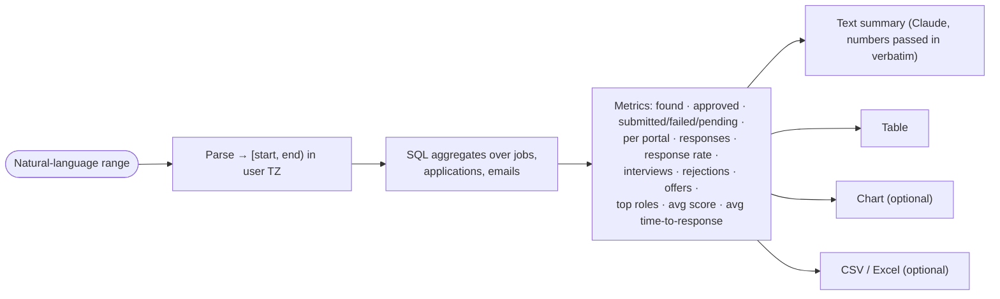

# Agent 9 · Analytics & Reporting

**Responsibility:** answer stats questions for any time window directly from raw records.

| Input | Output |
|-------|--------|
| `"stats for today"`, `"last 7 days"`, `"1 Oct to 15 Oct"` | `Report {summary_text, table, chart_path?, export_path?}` |

**Tools:** date-range parser, SQL aggregations, matplotlib chart, CSV/XLSX export.

Numbers come only from SQL; the LLM phrases the summary and never computes figures, so totals match raw records exactly.

## Harness & AI

| Aspect | Value |
|--------|-------|
| Model role (gateway) | fast (summary wording only) |
| RAG collections | none |
| Allowed tools | stats.query, export_csv, export_xlsx, render_chart |
| Tracing | one Langfuse span per run; tools, retrievals and generations nested |

Runs inside the [agent harness](../04-agent-harness.md): kill switch, allowlist, budgets, retries and approval binding apply to every tool call.
